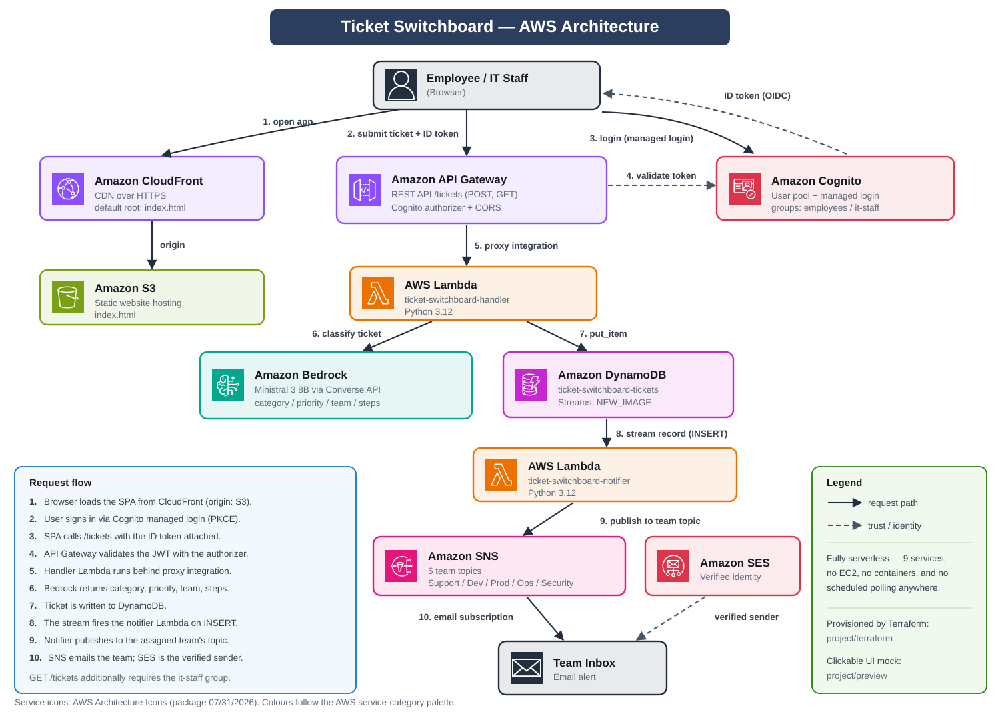
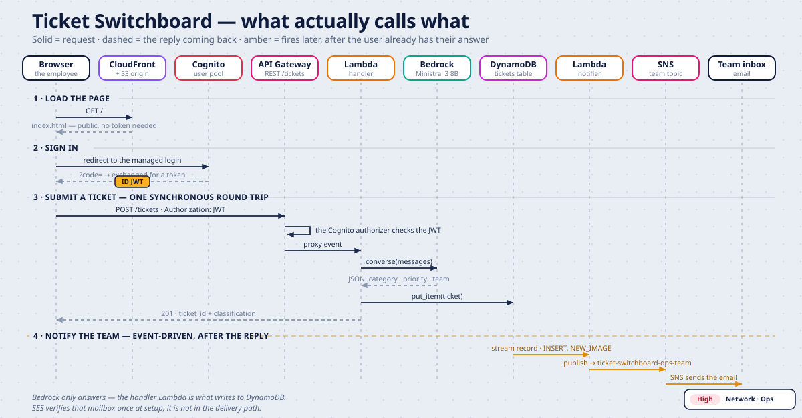

# Ticket Switchboard

Serverless AI help desk on AWS — Bedrock triages and routes IT tickets, Cognito
secures the API, DynamoDB Streams fire the alerts. One `terraform apply`.

## Overview

Employees describe an IT problem in plain English. A foundation model reads it,
assigns a category, a priority and an owning team, suggests resolution steps,
and the right team gets an email — in about a second, with no servers to run.

The whole stack is defined in Terraform. There is nothing to click in the
console to stand it up.

| Metric | Value | Why |
|---|---|---|
| **Difficulty** | Intermediate (3/5) | No hard algorithms — the challenge is wiring 9 services, their IAM, and two dependency traps Terraform makes explicit |
| **Depth** | Broad, shallow (2/5) | Touches a lot; each piece is the happy path. Input validation, model-output fallbacks and 26 tests lift the handler above the rest |
| **Maturity** | Dev / demo | Reproducible deploy, scoped IAM, tested — but no alarms, DLQ, CI or remote state, and the bucket is public by design |
| **Scope** | 9 AWS services · 2 Lambdas · 6 modules · ~56 resources · ~1.3k lines Terraform + 230 Python | An integration project, not an algorithms one |
| **Cost & build time** | <$0.50 · ~8 min to deploy | Fully serverless, teardown is one command |

Scored with [`docs/project-metrics.md`](docs/project-metrics.md).

## Contents

- [Business scenario](#business-scenario)
- [Architecture](#architecture)
- [Tech stack](#tech-stack)
- [Key features](#key-features)
- [Hardening backlog](#hardening-backlog)
- [Prerequisites](#prerequisites)
- [Getting started](#getting-started)
- [After deployment](#after-deployment)
- [Project structure](#project-structure)
- [Tests](#tests)
- [Clean up](#clean-up)
- [Cost](#cost)

## Business scenario

A large enterprise raises hundreds of IT requests a day — laptop failures, VPN
drop-outs, password resets, failed deployments, suspicious logins. The help
desk reads each one, guesses its category and urgency, and forwards it on by
hand. Tickets get lost, a printer complaint outranks a security incident, and
nobody can see who owns what.

Ticket Switchboard removes the triage step: the model classifies and routes
every ticket the moment it is submitted, and notifies the owning team directly.

## Architecture



> Not rendering? Open [`docs/architecture.html`](docs/architecture.html) in a
> browser for the interactive version.

The flow, end to end:

1. The browser loads the single-page app from CloudFront (origin: S3).
2. The user signs in through Cognito managed login (authorization code + PKCE).
3. The app calls `POST /tickets` with its ID token.
4. API Gateway validates the JWT, then invokes the handler Lambda.
5. The handler asks Bedrock to classify the ticket and writes it to DynamoDB.
6. The table's stream fires the notifier Lambda, which publishes to the
   assigned team's SNS topic. SNS emails the team.

### Call sequence



The same flow as a timeline — what is a synchronous round trip the user waits
on, and what fires afterwards off the DynamoDB stream. An animated version is
at [`docs/sequence-diagram.html`](docs/sequence-diagram.html).

## Tech stack

| Layer | Service | Role |
|---|---|---|
| AI | Amazon Bedrock | Classifies the ticket via the Converse API |
| Compute | AWS Lambda ×2 | Request handler, and stream-driven notifier |
| API | Amazon API Gateway | REST `/tickets`, Cognito authorizer, CORS |
| Auth | Amazon Cognito | User pool, managed login, `employees` / `it-staff` |
| Data | Amazon DynamoDB | Ticket store with a `NEW_IMAGE` stream |
| Delivery | Amazon S3 + CloudFront | Static site behind an HTTPS CDN |
| Messaging | Amazon SNS + SES | Five team topics, verified sender |
| IaC | Terraform ≥ 1.6, AWS provider 6.x | Six reusable modules |

Lambda code is Python 3.12, zipped at plan time — there is no build step.

## Key features

- **Deploys in one command.** No console clicking, no manual wiring.
- **Model-agnostic classification.** The handler uses the Converse API, so
  `bedrock_model_id` can change without touching code.
- **Group-based authorization.** Anyone may submit; only `it-staff` may list
  all tickets. Enforced from the `cognito:groups` claim.
- **Event-driven notifications.** DynamoDB Streams, not polling.
- **Least-privilege IAM.** Scoped inline policies per function, not
  `*FullAccess` managed policies.
- **Config injected at apply time.** API, Cognito and CloudFront values are
  templated into `index.html` — no hand-edited endpoints.
- **Tested offline.** 25 handler tests that need no AWS account.

## Hardening backlog

What "Dev / demo" above is standing in for. None of these are needed for a
demo; all of them would be needed to run it for real.

| Gap | Why it matters |
|---|---|
| No DLQ on either Lambda | A poison record on the stream retries until it expires, then is lost silently |
| Notifier is not idempotent | Stream delivery is at-least-once, so a retry can send a duplicate alert |
| No alarms or dashboards | Nothing reports a rising Bedrock error rate or a stuck iterator |
| Local Terraform state | No locking — concurrent applies would corrupt it. Needs S3 + DynamoDB |
| No CI | `fmt`, `validate` and the handler tests run only when someone remembers |
| Public S3 bucket | Required by the S3 *website* endpoint origin; CloudFront OAC with a REST origin removes it |
| No API throttling or WAF | The endpoint is open to the internet behind auth, with no rate limit |
| Single region, no DR | Fine for a lab; an outage takes the whole thing down |
| PITR disabled on the table | Deliberate for cost — a real ticket store wants it on |
| Test-user password in tfvars | Should come from Secrets Manager, not a variable |

## Prerequisites

| | |
|---|---|
| Terraform | ≥ 1.6 |
| AWS CLI | configured (`aws configure`) |
| AWS permissions | admin, or enough to create the services above |
| Region | `us-east-1` by default |
| An inbox you can open | for SES + five SNS confirmations, and the test user |

Nothing to enable in the Bedrock console — serverless models are subscribed on
first invocation.

## Getting started

```bash
cd terraform

cp terraform.tfvars.example terraform.tfvars
# set notification_email and test_user_password

terraform init
terraform plan          # review what will be created
terraform apply
```

Roughly 5–8 minutes, most of it CloudFront. `terraform output app_url` gives
you the URL.

Prefer not to keep the password in a file:

```bash
export TF_VAR_notification_email="you@example.com"
export TF_VAR_test_user_password='ChangeMe#2026'
terraform apply
```

## After deployment

Two things still need a human — `terraform output next_steps` repeats them:

1. **Confirm the emails.** AWS sends five SNS subscription confirmations plus
   an SES verification. Click every link, spam folder included. Until then
   tickets are classified and stored, but no alert is delivered.
2. **Sign in.** Open the app URL, log in as `testemployee` with your temporary
   password. Cognito will ask for a permanent one.

Then submit something like *"VPN keeps disconnecting every 10 minutes"* and
watch it route to the Ops team.

## Project structure

```
project/
├── terraform/          infrastructure — start at main.tf
│   ├── modules/        dynamodb, lambda, api_gateway, cognito,
│   │                   notifications, frontend
│   ├── lambda/         handler + notifier source (Python 3.12)
│   ├── frontend/       index.html template, filled in at apply time
│   └── tests/          offline handler tests
├── docs/               architecture diagram
└── preview/            clickable UI mock, no AWS needed
```

Two companion docs:

- [`terraform/README.md`](terraform/README.md) — every input variable, how the
  modules fit together, model selection, and troubleshooting.
- [`docs/manual-setup.md`](docs/manual-setup.md) — build the same architecture
  by hand in the AWS Console, if you want to learn what Terraform is doing.

## Tests

```bash
python terraform/tests/test_handler.py
```

Stubs boto3, so no credentials and no network. Covers the Bedrock request and
response shape, the classification fallbacks, `cognito:groups` parsing, and
HTTP routing.

## Clean up

```bash
cd terraform && terraform destroy
```

Removes everything. CloudFront takes 10–15 minutes to finish deleting — that
is normal.

## Cost

Roughly **$0.00–$0.50** for a 2–3 hour session, almost all of it Bedrock
inference at a fraction of a cent per ticket. Everything else sits inside the
free tier. Run `terraform destroy` when you are done: a CloudFront distribution
left enabled accrues charges over time.
